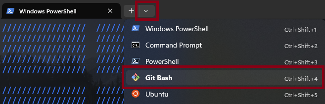
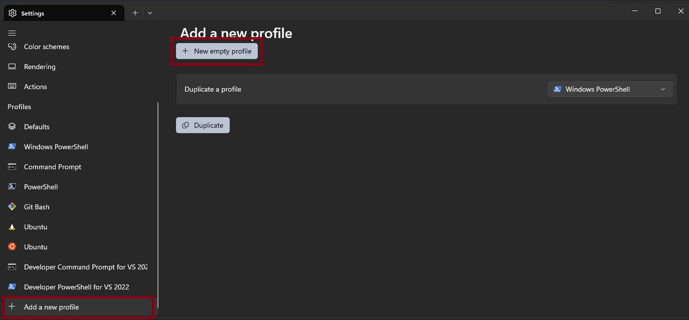
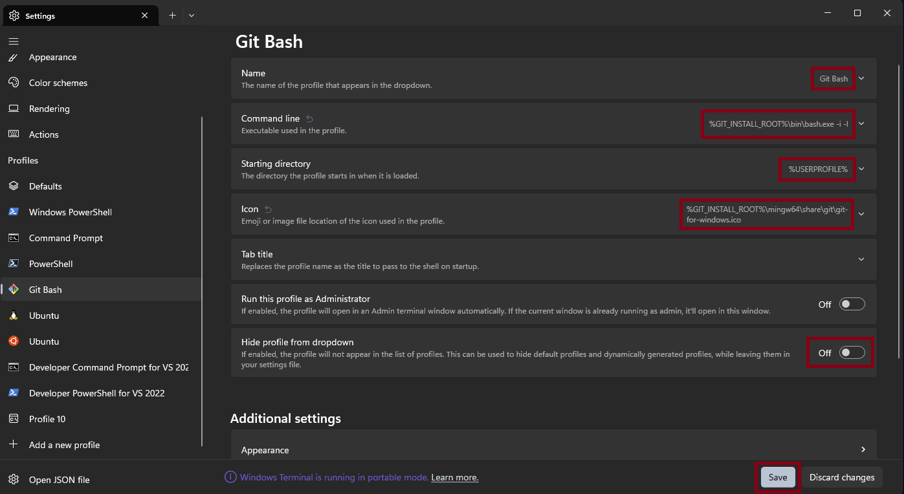
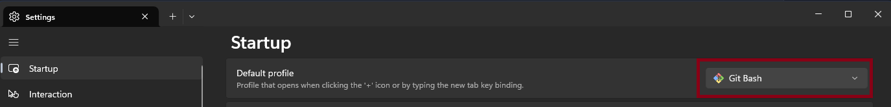

<p align=center>
<br>
<a href="http://makeapullrequest.com"></a>
<a href="#Linux">
<a href="#MacOS">
<a href="#Windows">
<a href="#Android">
<a href="#Steam-deck">
<a href="#iOS">
<br>
<p align=center>
<a href="https://discord.gg/aqu7GpqVmR"></a>
<a href="matrix.md"></a>
<br>
<a href="https://discord.gg/aqu7GpqVmR">Discord</a>
<a href="https://github.com/srajanbuilds/sranime-cli/blob/main/matrix.md">Matrix</a>
</p>
<a href="https://github.com/port19x"></a>
<a href="https://github.com/CoolnsX"></a>
<a href="https://github.com/justchokingaround"></a>
<a href="https://github.com/Derisis13"></a>
<a href="https://github.com/71zenith"></a>
<a href="https://github.com/vorlie"></a>

</p>

<h3 align="center">
A cli to browse and watch anime (alone AND with friends). This tool scrapes the site <a href="https://hianime.at/">hianime.</a>
</h3>

<h1 align="center">
	Showcase
</h1>

[sranime-cli-demo.webm](https://user-images.githubusercontent.com/44473782/224679247-0856e652-f187-4865-bbcf-5a8e5cf830da.webm)

## Table of Contents

- [Features](#features)
- [CLI Options Reference](#cli-options-reference)
- [Usage Examples](#usage-examples)
- [Configuration](#configuration)
- [Fixing errors](#fixing-errors)
- [Install](#install)
  - [⚡ Quick Install (1-Line)](#-quick-install-1-line)
  - [📦 Prerequisites & Installing Dependencies](#-prerequisites--installing-dependencies)
  - [Package Managers & Native Packages](#package-managers--native-packages)
  - [From Source](#installing-from-source)
- [Uninstall](#uninstall)
- [Dependencies](#dependencies)
  - [Ani-Skip](#ani-skip)
- [FAQ](#faq)
- [Homies](#homies)
- [Contribution Guidelines](./CONTRIBUTING.md)
- [Disclaimer](./disclaimer.md)

## Features

- **Zero-Downtime Multi-Provider Streaming**: Automatic failover across `hianime` (default), `allanime`, and `gogo` providers (`-p, --provider`).
- **Rich Terminal UI & Poster Art**: Dual-column `fzf` side preview pane with ANSI metadata cards, English/Japanese titles, synopsis, watched indicators, and terminal cover art via `chafa`.
- **Lifetime Watch Journal & Analytics**:
  - Append-only TSV journal (`$XDG_STATE_HOME/sranime-cli/watch.log`).
  - Chronological history viewer with title and date range filters (`sranime-cli -W "Frieren"`, `sranime-cli -W "2026-09-01..2026-09-30"`).
  - Personal viewing statistics (`sranime-cli --watch-stats`) computing total watch time, top series, and viewing streaks via a pure POSIX Julian Day algorithm.
  - Data portability with structured JSON and CSV exports (`sranime-cli --watch-export json`).
- **Dual-Tracker Cloud Synchronization (AniList & MyAnimeList)**:
  - Interactive OAuth2 PKCE login for AniList and MyAnimeList (`sranime-cli --login anilist`, `sranime-cli --login mal`).
  - Seamless dual scrobbling: MPV playback hook automatically syncs progress to both AniList and MyAnimeList concurrently.
  - Direct cloud watchlist resumption: `sranime-cli --sync` opens your cloud Currently Watching list and launches the next episode in one click.
  - Two-way library portability: Export your lifetime watch log to standard MyAnimeList XML (`--export-mal [file]`) and import existing libraries (`--import-mal <file>`).
  - Non-interactive watchlist inspection via `sranime-cli --sync-list` and account status via `sranime-cli --scrobble-status`.
- **High-Speed Chunked Downloads, Media Server Bridge & Queue Daemon**:
  - Accelerated 16-connection parallel chunk downloads with `aria2c` (with fallback to `yt-dlp`, `ffmpeg`, and `curl`).
  - Flexible episode range parser supporting single, discrete, and bulk ranges: `-d -e 1-12`, `-d -e 1,3,5-8`, or `-d -e all`.
  - Plex and Jellyfin standardized season folder organization (`${download_dir}/${anime}/Season 01/...`).
  - Automated Jellyfin, Plex & Kodi `.nfo` metadata generation (`--nfo`) creating `tvshow.nfo` and episode `.nfo` files with full synopsis, studio, genres, and artwork (`poster.jpg`, `fanart.jpg`).
  - External subtitle sidecar extraction (`--save-subs`) preserving `.vtt`/`.srt` files matching video filenames.
  - Asynchronous background download queue daemon (`--queue`, `--queue-status`, `--queue-start`, `--queue-pause`, `--queue-resume`, `--queue-clear`).
- **Social & Multiplayer Watch Parties**:
  - Native Discord IPC Rich Presence client (`--discord`, `--no-discord`) displaying live episode progress and player art.
  - Synchronized watch parties with friends via Turnkey Syncplay integration: `sranime-cli --room FridayNight "Sousou no Frieren"`.
- **Continuous Autoplay Binging & Smart Resumption**:
  - Seamless continuous binge-watching (`-A, --autoplay`, `--autoplay-limit [count]`) automatically streaming subsequent episodes with countdown intermission.
  - Exact timestamp-precision resumption (`-R, --resume`) saving playback position down to the second via an MPV Lua observer.
  - Arbitrary timestamp seek on start (`--start-time MM:SS`) and active checkpoint inspection (`--show-checkpoints`, `--clear-checkpoints`).
- **Intelligent Discovery Engine**:
  - Zero-query seasonal anime browser (`--seasonal [season] [year]`) and trending releases (`--trending`).
  - Airing calendar with live countdown timers (`--calendar / --schedule [hours]`).
  - Graph-based recommendations engine (`--similar [title]`) querying AniList community votes.
- **Multi-Language Subtitles & Dub Audio**:
  - Preferred subtitle language selection (`--sub-lang <lang>` e.g. `es`, `fr`, `de`, `it`, `pt`, `ar`, `en`).
  - Audio stream selection (`--audio-lang <lang>` e.g. `ja`, `en`, `es`) with automatic MPV/IINA/VLC flag generation.
  - Multi-language subtitle track sidecar preservation on downloads (`--save-subs`).
- **Turnkey Smart TV & Chromecast Casting**:
  - Direct 1-command casting to living room TV, Chromecast, or Apple TV via `catt` (`sranime-cli --cast "Living Room TV"`).
  - Network device scanner (`sranime-cli --cast-devices`) to detect all Cast-enabled screens on local Wi-Fi.
- **Embedded Local LAN Web Companion**:
  - Zero-runtime mobile-responsive web dashboard served over your home network (`sranime-cli --web 7777`).
  - Browse watch history, discover seasonal releases, and trigger desktop playback or TV casting straight from your phone or tablet.
- **Cross-Platform & POSIX Compliant**: Works seamlessly on Linux, macOS, and Windows (PowerShell/CMD/Git Bash), with zero mandatory runtime overhead.

## CLI Options Reference

| Flag / Option | Arguments | Default | Description |
| :--- | :--- | :--- | :--- |
| **Search & Playback** | | | |
| `-c, --continue` | — | — | Continue watching from the last played episode in history |
| `-A, --autoplay` | — | Disabled | Automatically stream subsequent episodes continuously |
| `--autoplay-limit` | `<count>` | Unlimited | Limit number of consecutive episodes in autoplay binge mode |
| `-R, --resume` | — | Disabled | Resume playback from the exact saved timestamp checkpoint |
| `--start-time` | `<time>` | 0 | Seek to timestamp (`MM:SS`, `HH:MM:SS`, or seconds) on start |
| `--show-checkpoints`| — | — | Display table of in-progress anime titles and timestamps |
| `--clear-checkpoints`| — | — | Clear all stored playback timestamp checkpoints |
| `-e, --episode` | `<num>` | — | Select a specific episode number to stream or download |
| `-r, --range` | `<range>` | — | Select an episode range (e.g. `1-12`, `1,3,5`, `all`) |
| `-S, --select-nth` | `<index>` | — | Auto-select nth search result directly without interactive menu |
| `-p, --provider` | `<name>` | `hianime` | Preferred stream provider (`hianime`, `allanime`, `gogo`) |
| `--list-providers` | — | — | List all available stream extraction providers |
| `-q, --quality` | `<quality>`| `best` | Video quality (`best`, `1080p`, `720p`, `480p`, `360p`, `worst`) |
| `--dub` | — | `sub` | Prefer English dubbed stream audio when available |
| `-v, --vlc` | — | `mpv` | Use VLC media player instead of default MPV |
| `--skip` | — | Disabled | Use `ani-skip` to automatically skip anime opening intros |
| `--no-detach` | — | Detached | Keep player attached to terminal (useful for terminal MPV) |
| `--exit-after-play` | — | Disabled | Exit player and return player exit code |
| `--sub-lang, -sl` | `<lang>` | `en` | Preferred subtitle language code (e.g. `es`, `fr`, `de`, `it`, `pt`, `ar`, `en`) |
| `--audio-lang, -al`| `<lang>` | `ja` | Preferred audio language code (e.g. `ja`, `en`, `es`) |
| `--cast` | `[device]` | — | Cast streaming video directly to a Smart TV or Chromecast via `catt` |
| `--cast-devices` | — | — | Scan the local WiFi network for discoverable Cast targets |
| `--web` | `[port]` | `7777` | Start local LAN web companion microserver for phone/tablet control |
| `--web-stop` | — | — | Stop the background web companion microserver |
| `--web-status` | — | — | Display status and active PID of the web companion microserver |
| **Discovery & Recommendations** | | | |
| `--seasonal` | `[season] [yr]` | Current | Browse popular anime of the current or specified broadcast season |
| `--trending` | — | — | Browse top trending anime releases right now |
| `--calendar, --schedule` | `[hours]` | 24 | Display upcoming broadcast calendar with live countdowns |
| `--similar` | `[title]` | — | Discover community recommendations based on an anime series |
| **Cloud Trackers & Library** | | | |
| `--login` | `[anilist\|mal]`| `anilist` | Authenticate with AniList or MyAnimeList cloud trackers |
| `--scrobble-status` | — | — | Display authentication and connection status for linked accounts |
| `--logout` | `[anilist\|mal]`| All | Log out and clear stored credentials for tracking services |
| `--sync` | — | — | Interactive selection menu populated with your AniList Currently Watching |
| `--sync-list` | — | — | Display your Currently Watching watchlist with progress and exit |
| `--no-scrobble` | — | Enabled | Disable automatic episode progress scrobbling for this session |
| `--export-mal` | `[path]` | Stdout | Export lifetime watch history in standard MyAnimeList XML format |
| `--import-mal` | `<file.xml>` | — | Import watch history from MyAnimeList XML file into watch journal |
| **Media Server & Downloads** | | | |
| `-d, --download` | — | Stream | Download video stream to disk instead of launching player |
| `--download-dir` | `<path>` | `~/Downloads`| Set destination directory for downloaded anime files |
| `--nfo` | — | Disabled | Generate Kodi/Jellyfin/Plex `.nfo` metadata and download artwork |
| `--save-subs` | — | Disabled | Concurrently extract and save external `.vtt`/`.srt` subtitle sidecars |
| `--queue` | — | Disabled | Enqueue episode download asynchronously to background queue |
| `--queue-status` | — | — | Display dashboard table of queued, active, and completed downloads |
| `--queue-start` | — | — | Start background download queue daemon worker |
| `--queue-pause` | — | — | Pause background download queue processing |
| `--queue-resume` | — | — | Resume background download queue processing |
| `--queue-clear` | `[completed\|all]` | `completed` | Purge finished or all items from download queue |
| **History, Journal & Social** | | | |
| `-W, --watch-log` | `[filter]` | All | Display chronological watch log (filter by title or date range) |
| `--watch-stats` | — | — | Display lifetime viewing analytics, hours watched, and streaks |
| `--watch-export` | `[json\|csv]` | `json` | Export lifetime watch log to structured JSON or CSV |
| `--clear-watch-log`| — | — | Clear the lifetime watch log journal |
| `--show-history` | — | — | Display recent watch history |
| `-D, --clear-history` | — | — | Clear recent watch history |
| `-s, --syncplay` | — | Disabled | Launch Syncplay watch party to synchronize playback with friends |
| `--room` | `<name>` | `WatchParty` | Set room name for Syncplay watch party |
| `--discord` | — | Enabled | Enable native Discord Rich Presence IPC integration |
| `--no-discord` | — | — | Disable Discord Rich Presence IPC integration |
| **Configuration & Diagnostics** | | | |
| `--edit-config` | — | — | Open configuration file in default `$EDITOR` |
| `--dump-config` | — | — | Print active configuration values and exit |
| `--validate-config`| — | — | Validate syntax of user configuration file |
| `--doctor` | — | — | Run comprehensive system diagnostics and dependency check |
| `-V, --version` | — | — | Print script version and exit |
| `-h, --help` | — | — | Print help options and exit |

## Usage Examples

### 1. Fast Streaming & Binge Watching
```sh
# Search and stream with interactive fzf metadata cards
sranime-cli "Sousou no Frieren"

# Binge watch continuously from episode 1 to 5 with autoplay
sranime-cli -A --autoplay-limit 5 -e 1 "Bocchi the Rock!"

# Resume playback from the exact second you left off
sranime-cli -R "Solo Leveling"

# Start at an exact timestamp (MM:SS)
sranime-cli --start-time 14:30 -e 4 "Chainsaw Man"
```

### 2. Intelligent Discovery & Schedules
```sh
# Browse top popular anime airing this current season
sranime-cli --seasonal

# Browse upcoming schedule with live countdown timers
sranime-cli --calendar 48

# Get community recommendations based on an anime series
sranime-cli --similar "Steins;Gate"
```

### 3. Cloud Tracking & Portability
```sh
# Authenticate with AniList and MyAnimeList
sranime-cli --login anilist
sranime-cli --login mal

# Check connected accounts status
sranime-cli --scrobble-status

# Export local watch journal to MyAnimeList XML backup
sranime-cli --export-mal ~/Documents/my_anime_library.xml

# Import existing MyAnimeList XML backup into local watch journal
sranime-cli --import-mal ~/Downloads/mal_export.xml
```

### 4. Media Server Downloads & Background Queue
```sh
# Download batch episodes with Jellyfin/Plex .nfo metadata and artwork
sranime-cli -d -e 1-12 --nfo --save-subs "Dungeon Meshi"

# Enqueue an episode to the background download queue
sranime-cli -d -e 14 --queue "Frieren"

# Check background queue status and start the daemon worker
sranime-cli --queue-status
sranime-cli --queue-start
```

### 5. Multi-Language Subtitles, Casting & Web Companion
```sh
# Stream with Spanish subtitles and Japanese audio
sranime-cli --sub-lang es "Sousou no Frieren"

# Stream with French subtitles
sranime-cli --sub-lang fr "Attack on Titan"

# Scan available Smart TVs and Chromecasts on local Wi-Fi
sranime-cli --cast-devices

# Beam episode directly to living room TV
sranime-cli --cast "Living Room TV" "Steins;Gate"

# Launch local LAN web companion on port 7777 (browse from your phone!)
sranime-cli --web 7777

# Check status or stop the web companion
sranime-cli --web-status
sranime-cli --web-stop
```

### 6. Viewing Journal & Analytics
```sh
# Inspect lifetime watch statistics and viewing streaks
sranime-cli --watch-stats

# Filter watch history by date range
sranime-cli -W "2026-09-01..2026-09-30"

# Export watch history to JSON
sranime-cli --watch-export json > watch_history.json
```

## Configuration

You can customize `sranime-cli` defaults using a configuration file located at `~/.config/sranime-cli/sranime-cli.conf` or `/etc/sranime-cli/sranime-cli.conf`.

An example template `sranime-cli.conf` is provided in the repository:

```sh
# Preferred video player (e.g. mpv, vlc, iina)
player="mpv"

# Preferred audio mode: sub, dub
mode="sub"

# Default video quality: best, 1080p, 720p, 480p, 360p, worst
quality="best"

# Default download directory
download_dir="$HOME/Downloads"

# Interactive menu program: fzf, rofi, dmenu
menu_program="fzf"

# Automatically skip intros with ani-skip (mpv only)
skip_intro=0
```

Environment variables (e.g. `SRANIME_CLI_PLAYER`, `SRANIME_CLI_QUALITY`) will override settings specified in the configuration file.

Quick management:
- Run `sranime-cli --edit-config` to quickly open or create your config file in your preferred `$EDITOR`.
- Run `sranime-cli --dump-config` to inspect active configuration values.

## Fixing errors

If you encounter `Blocked by cloudflare. Try installing curl-impersonate` then install `curl-impersonate` from your respective package manager.
If it is not available, then download from their [github](https://github.com/lwthiker/curl-impersonate) by running the following commands.

```sh
curl -LO "https://github.com/lwthiker/curl-impersonate/releases/download/v0.6.1/curl-impersonate-v0.6.1.x86_64-linux-gnu.tar.gz"
sudo tar xf curl-impersonate-v0.6.1.x86_64-linux-gnu.tar.gz -C /usr/local/bin
```

For any other breaking issue, then make sure you are on **latest version** by typing `sudo sranime-cli -U` to update on Linux, Mac and Android. On Windows, run `sranime-cli -U`.
If after this the issue persists then open an issue.

## Install

### ⚡ Quick Install (1-Line)

Get `sranime-cli` up and running in seconds with a single command:

#### Linux, macOS & Android (Termux)
```sh
curl -fsSL https://raw.githubusercontent.com/srajanbuilds/sranime-cli/main/install.sh | sh
```
*Downloads and links `sranime-cli` and all modular engines into `/usr/local/bin` (or `~/.local/bin` / Termux `$PREFIX/bin`).*

#### Windows (PowerShell)
```powershell
irm https://raw.githubusercontent.com/srajanbuilds/sranime-cli/main/install.ps1 | iex
```
*Downloads `sranime-cli` to `%USERPROFILE%\.sranime-cli`, generates command shims, and automatically adds it to your User `$PATH`.*

---

### 📦 Prerequisites & Installing Dependencies

`sranime-cli` is lightweight and modular. Install the required and recommended tools for your operating system using one of the quick copy-paste commands below:

| Dependency | Status | Purpose |
| :--- | :---: | :--- |
| **`curl`** | **Required** | Fast HTTP/HTTPS scraping and API queries |
| **`mpv`** (or `iina`) | **Required** | Video playback engine with Lua scrobbling & checkpoints |
| **`fzf`** | **Required** | Interactive fuzzy search menu & dual-column preview pane |
| **`aria2`** (`aria2c`) | **Recommended** | Accelerated 16-connection parallel chunk downloading |
| **`chafa`** | **Recommended** | High-definition ANSI/Sixel anime poster art in terminal cards |
| **`yt-dlp`** | **Recommended** | Stream extractor and HLS media segment fallback |
| **`ffmpeg`** | Optional | Media stream muxing and audio conversion fallback |
| **`ani-skip`** | Optional | Automatic anime opening & ending intro skipping |

#### Install All Dependencies by Operating System

<details open><summary><b>Ubuntu / Debian / Linux Mint / Pop!_OS</b></summary>

```sh
sudo apt update && sudo apt install -y curl mpv fzf aria2 chafa yt-dlp
```
</details>

<details><summary><b>Arch Linux / Manjaro / EndeavourOS</b></summary>

```sh
sudo pacman -S --needed curl mpv fzf aria2 chafa yt-dlp
```
</details>

<details><summary><b>Fedora / RHEL</b></summary>

```sh
sudo dnf install -y curl mpv fzf aria2 chafa yt-dlp
```
*(Note: If `mpv` is not in Fedora's base repos, enable RPM Fusion: `sudo dnf install https://mirrors.rpmfusion.org/free/fedora/rpmfusion-free-release-$(rpm -E %fedora).noarch.rpm`)*
</details>

<details><summary><b>openSUSE (Tumbleweed / Leap)</b></summary>

```sh
sudo zypper install -y curl mpv fzf aria2 chafa yt-dlp
```
</details>

<details><summary><b>Void Linux</b></summary>

```sh
sudo xbps-install -Sy curl mpv fzf aria2 chafa yt-dlp
```
</details>

<details><summary><b>Alpine Linux</b></summary>

```sh
sudo apk add curl mpv fzf aria2 chafa yt-dlp
```
</details>

<details open><summary><b>macOS (Homebrew)</b></summary>

```sh
# Using mpv
brew install curl mpv fzf aria2 chafa yt-dlp

# Or using IINA (native macOS player):
brew install curl fzf aria2 chafa yt-dlp && brew install --cask iina
```
</details>

<details open><summary><b>Windows</b></summary>

Open **PowerShell** and choose your preferred package manager:

**Option 1: Scoop (Recommended)**
```powershell
scoop install git mpv fzf aria2 chafa yt-dlp
```

**Option 2: Windows Package Manager (winget)**
```powershell
winget install Git.Git mpv.net junegunn.fzf aria2.aria2 yt-dlp.yt-dlp
```

**Option 3: Chocolatey**
```powershell
choco install git mpv fzf aria2 yt-dlp
```
*Note: Git for Windows provides `bash.exe`, `curl`, `grep`, and `sed` which `sranime-cli` uses seamlessly.*
</details>

<details><summary><b>Android (Termux)</b></summary>

```sh
pkg up -y && pkg install -y curl mpv fzf aria2 chafa yt-dlp
# Required on Android 14+
pkg install termux-am
```
</details>

<details><summary><b>Steam Deck (SteamOS Desktop Mode)</b></summary>

Switch to Desktop Mode and open `Konsole`:
```sh
# Flatpak MPV player
flatpak install -y flathub io.mpv.Mpv

# CLI tools
curl -L https://github.com/yt-dlp/yt-dlp/releases/latest/download/yt-dlp -o ~/.local/bin/yt-dlp && chmod +x ~/.local/bin/yt-dlp
```
</details>

<details><summary><b>FreeBSD</b></summary>

```sh
sudo pkg install -y curl mpv fzf aria2 chafa yt-dlp
```
</details>

> [!TIP]
> **Verify Your Setup:** Run `sranime-cli --doctor` anytime to automatically verify all installed dependencies and player integrations.

---

### Package Managers & Native Packages

[](https://repology.org/project/sranime-cli/versions)

#### Tier 1 Support: Linux, Mac, Android

*These Platforms have rock solid support and are used by maintainers and large parts of the userbase.*

<details><summary><b>Linux</b></summary>

#### Native Packages

*Native packages have a more robust update cycle, but sometimes they are slow to upgrade. \
If the one for your platform is up-to-date we suggest going with it.*

<details><summary>Debian 13/unstable</summary>

```sh
sudo apt install sranime-cli
```
</details>

<details><summary>Fedora</summary>

To install mpv (and vlc) you need _RPM Fusion free_ enabled. Simply follow the instructions here: https://rpmfusion.org/Configuration
To be able to install syncplay, you'll need to enable this copr repo (instructions included): https://copr.fedorainfracloud.org/coprs/batmanfeynman/syncplay/.

To install sranime-cli:
```sh
sudo dnf copr enable derisis13/sranime-cli
sudo dnf install sranime-cli
```
*If for your distro uses rpm and you would like to see a native package, open an issue.*

</details><details><summary>Arch</summary>

Build and install from the AUR:
```sh
yay -S sranime-cli
```
Also consider `sranime-cli-git`

</details><details><summary>Gentoo</summary>

Build and install from the GURU:
```sh
sudo eselect repository enable guru
sudo emaint sync -r guru
sudo emerge -a sranime-cli
```
Consider using the 9999 ebuild.
```sh
sudo emerge -a =app-misc/sranime-cli-9999
```

</details><details><summary>OpenSuse</summary>

On Suse the provided MPV and VLC packages are missing features that are used by sranime-cli. The only required is the "Only Essentials" repository which has versions for each Suse release.
You can find instructions on this [here](https://en.opensuse.org/Additional_package_repositories#Packman).

To add the sranime-cli copr repo, update then install sranime-cli run (on both versions):
```sh
zypper addrepo https://download.copr.fedorainfracloud.org/results/derisis13/sranime-cli/opensuse-tumbleweed-x86_64/ sranime-cli
zypper dup
zypper install sranime-cli
```
You'll get a warning about `Signature verification failed [4-Signatures public key is not available]` but this can be ignored from the prompt.

*Note: package is noarch, so any architecture should work, even though the repo is labelled x86-64*

</details></details><details><summary><b>MacOS</b></summary>

Install [HomeBrew](https://docs.brew.sh/Installation) if not installed.

```sh
brew tap srajanbuilds/sranime-cli https://github.com/srajanbuilds/sranime-cli.git
brew trust srajanbuilds/sranime-cli
brew install sranime-cli && brew install --cask iina
```
*Why iina and not mpv? Drop-in replacement for mpv for MacOS. Integrates well with OSX UI. Excellent support for M1. Open Source.*

</details><details><summary><b>Android</b></summary>

Install termux [(Guide)](https://termux.com/)

#### Termux package

```sh
pkg up -y
pkg install sranime-cli
```
If you're using Android 14 make sure to run this due to [#1206](https://github.com/srajanbuilds/sranime-cli/issues/1206):
```sh
pkg install termux-am
```

For players you can use the apk (playstore/fdroid) versions of mpv and vlc. Note that these cannot be checked from termux so a warning is generated when checking dependencies.

**Important Note:** The streams only play with the right referrer, which mpv on Android has to read from a config file:
- Run this command and allow storage permissions:
```sh
termux-setup-storage
```
- Go to MPV > Settings > Advanced > mpv.conf
- add this line:
```txt
include="/storage/emulated/0/mpv/mpv.config.mp4"
```
- Make sure to have storage (photos and videos on newer android) permission allowed to both MPV and termux. These permissions are asked by mpv if you click on the "file picker (legacy)" option.

VLC on Android cannot be given the referrer, so it does not play the current provider.

</details>

### Tier 2 Support: Windows, WSL, iOS, Steam Deck, FreeBSD, Ubuntu Touch

*While officially supported, installation is more involved on these platforms and sometimes issues arise. \
Reach out if you need help.*

<details><summary><b>Windows</b></summary>

`sranime-cli` is on scoop. Please read further for setup instructions.

We will set up the bash.exe that comes with Git for Windows to be used with Windows Terminal. You may use terminals such as Wezterm or Alacritty, but this guide only covers Windows Terminal. The Git Bash terminal (i.e., mintty) [has problems with fzf](#windows-known-problems-and-solutions).

First, you'll need to install the scoop package manager. [(Install)](https://scoop.sh/) Follow **quickstart**.

Next, get Windows Terminal. It comes preinstalled on Windows 11. If you do not have it, install it by running the following commands in powershell.

```sh
scoop bucket add extras
scoop install extras/windows-terminal
```

Next, get git. If you have it, please update it. If you do not already have it, install it by running `scoop install git` in powershell.

Ensure that Git Bash is present in the Windows Terminal tab drop down, as shown below.



If it is not there, please add it. To add it, first click the drop-down button beside the new tab button (shown above).

Then, navigate to `Settings > Profiles > Add a new profile`. Click `+ New empty profile`.



Next:
- If you installed git with scoop: Set *Name* as "Git Bash", set *Command line* as `%GIT_INSTALL_ROOT%\bin\bash.exe -i -l`, and set *Icon* as `%GIT_INSTALL_ROOT%\mingw64\share\git\git-for-windows.ico`.
- If you installed git by other means: Set *Name* as "Git Bash", set *Command line* as `C:\Program Files\Git\bin\bash.exe -i -l`, and set *Icon* as `C:\Program Files\Git\mingw64\share\git\git-for-windows.ico`.

Next, set *Starting Directory* to `%USERPROFILE%`, and ensure that *Hide profile from dropdown* is set to "Off" (otherwise you won't be able to see this profile in the drop down).



Now save your changes.

You will use this profile to run `sranime-cli` in this bash shell.
Under Startup in Windows Terminal Settings, you may set this profile as the default so that you do not have to switch to it every time you want to run `sranime-cli`.



Now restart Windows Terminal. In the Git Bash profile, install `sranime-cli` by running the following commands.

```sh
scoop bucket add extras
scoop install sranime-cli
```

Next, install its dependencies.

```sh
scoop bucket add extras
scoop install fzf ffmpeg mpv
```

Consider also installing `yt-dlp` for downloading to work.

Restart Windows Terminal. Go to the Git Bash profile and update `sranime-cli` with `sranime-cli -U`. You will use this keep sranime-cli up-to-date.

Now you can use sranime-cli. Read the output of `sranime-cli -h` for more help.

#### Windows: Known Problems and Solutions

If you have a problem, please update sranime-cli to the latest version with `sranime-cli -U`. If you still have a problem, please read further.

- Stuck in "Search anime:". This shouldn't happen if you are using the Windows Terminal + Bash setup described above. It happens if you are using the Git Bash terminal (i.e., the mintty terminal). This is a problem between fzf and mintty, which should be resolved in future versions of fzf. For the time being, either use the Windows Terminal setup described above or, if you are dead-set on using the mintty terminal, run `export MSYS=enable_pcon` before running sranime-cli.
- "No such file or directory" or WSL-related errors: This shouldn't happen if you are using the Window Terminal + Bash setup described above. This happens if you run sranime-cli in powershell or cmd. This is due WSL's bash.exe being called instead of Git for Windows' bash.exe in `%USERPROFILE%\scoop\shims\sranime-cli.cmd`. If you must use powershell or cmd, edit the `%USERPROFILE%\scoop\shims\sranime-cli.cmd` file. In File Explorer, go to the `C:\Users\USERNAME\scoop\shims` directory and open the `sranime-cli.cmd` file with notepad. Next:
    - If you installed git with scoop, replace `@bash` with `@"%GIT_INSTALL_ROOT%\bin\bash.exe"`, or
    - If you installed git by other means, replace `@bash` with `@"C:\Program Files\Git\bin\bash.exe"`.
This should be fixed if the sranime-cli scoop manifest gets updated in [this PR](https://github.com/ScoopInstaller/Extras/pull/13342).
- curl can cause issues. sranime-cli has been tested unsuccessfully with curl `7.83.1` and successfully with `7.86.0`. If you run into issues, try installing a newer one with scoop.
- If you installed mpv with scoop, your mpv configuration will get read from `C:\Users\USERNAME\scoop\apps\mpv\current\portable_config`. See [the mpv documentation](https://mpv.io/manual/stable/) regarding `portable_config` for more details.

</details><details><summary><b>WSL</b></summary>

Follow the installation instructions of your Linux distribution.

Note that the media player (mpv or vlc) will need to be installed on Windows, not WSL. See the justification for this in the comment [(here)](https://github.com/srajanbuilds/sranime-cli/issues/1266#issuecomment-1926945757). Instructions on how to use the media player from WSL instead are also included in the linked comment.

When installing the media player on Windows, make sure that it is on the Windows Path. An easy way to ensure this is to download the media player with a package manager (on Windows, not WSL) such as scoop.

</details><details><summary><b>iOS</b></summary>

Install iSH and VLC from the app store.

Make sure apk is updated using
```
cat > /etc/apk/repositories <<'EOF'
https://dl-cdn.alpinelinux.org/alpine/edge/main
https://dl-cdn.alpinelinux.org/alpine/edge/community
https://dl-cdn.alpinelinux.org/alpine/edge/testing
EOF

apk update
apk add --upgrade apk-tools
apk upgrade --available
```

Further details: https://github.com/ish-app/ish/issues/2530

Then run this:
```sh
apk add grep sed curl-impersonate bash fzf git ncurses patch ffmpeg
git clone --depth 1 https://github.com/srajanbuilds/sranime-cli ~/.sranime-cli
cp ~/.sranime-cli/sranime-cli /usr/local/bin/sranime-cli
chmod +x /usr/local/bin/sranime-cli
rm -rf ~/.sranime-cli
```
For Downloads on iOS in iSH, omit the usual `-d` flag and instead select the Download option in VLC:


</details>

<details><summary><b>Steam Deck</b></summary>

#### Copypaste script:

* Switch to Desktop mode (`STEAM` Button > Power > Switch to Desktop)
* Open `Konsole` (Steam Deck Icon in bottom left corner > System > Konsole)
* Copy the script, paste it in the CLI and press Enter("A" button on Steam Deck)

```sh
[ ! -d ~/.local/bin ] && mkdir ~/.local/bin && echo "export PATH=$HOME/.local/bin:\$PATH" >> ".$(echo $SHELL | sed -nE "s|.*/(.*)\$|\1|p")rc"

git clone --depth 1 https://github.com/junegunn/fzf.git ~/.fzf
~/.fzf/install

curl -L https://github.com/yt-dlp/yt-dlp/releases/latest/download/yt-dlp -o ~/.local/bin/yt-dlp
chmod +x ~/.local/bin/yt-dlp

mkdir ~/.patch
curl -o ~/.patch/patch.tar.zst https://mirror.sunred.org/archlinux/core/os/x86_64/patch-2.8-1-x86_64.pkg.tar.zst
tar xvf ~/.patch/patch.tar.zst -C ~/.patch/
cp ~/.patch/usr/bin/patch ~/.local/bin/

git clone https://github.com/srajanbuilds/sranime-cli.git ~/.sranime-cli
cp ~/.sranime-cli/sranime-cli ~/.local/bin/

flatpak install io.mpv.Mpv
```
press enter("A" button on Steam Deck) on questions

##### 🎵 Theme Song Jukebox & Anime OSTs
Stream or download creditless Opening and Ending theme songs directly from AnimeThemes.moe:
```sh
sranime-cli --theme "Frieren"                # Interactive OP/ED jukebox
sranime-cli --theme "Frieren" -ao            # Background audio-only stream (no video window)
sranime-cli --theme "Frieren" --theme-type op # Only show Opening songs
sranime-cli --theme "Frieren" --theme-download # Download creditless 1080p/720p WebM
```

### ⏰ Simulcast Airing Alarms & Broadcast Alerts
Keep track of upcoming releases matching shows you actually watch:
```sh
sranime-cli --notify-airing                  # Send desktop notification for shows airing soon
sranime-cli --calendar --mine                # Personalized upcoming broadcast schedule
```

### 📁 Offline Mode & Local Vault Player
Play your offline library with zero network dependency while retaining subtitles and checkpoints:
```sh
sranime-cli --offline                        # Browse & play downloaded vault
sranime-cli --local ~/Videos/Anime           # Specify custom offline directory
```

### 🎨 Terminal Color Theme Presets
Choose a curated aesthetic for `fzf` menus and preview cards:
```sh
sranime-cli --color-theme catppuccin        # Catppuccin Mocha
sranime-cli --color-theme dracula           # Dracula Vampire
sranime-cli --color-theme nord              # Arctic Nord Frost
sranime-cli --color-theme cyberpunk         # Neon Cyberpunk
sranime-cli --color-themes                  # Display visual swatch gallery
```

### 🎮 In-Player MPV HUD & Hotkeys
Navigate your autoplay binge directly from the player window:
- **`N`**: Jump to **Next Episode** immediately.
- **`P`**: Jump to **Previous Episode** immediately.
- **`B`**: Save a **Bookmark / Checkpoint** and flash OSD timestamp.
- **`S`**: Cycle subtitle tracks with enhanced on-screen banner.

## Installation in steps:

##### Install mpv (Flatpak version):

```sh
flatpak install io.mpv.Mpv
```
press enter("A" button on Steam Deck) on questions

##### Install [fzf](https://github.com/junegunn/fzf):

```sh
git clone --depth 1 https://github.com/junegunn/fzf.git ~/.fzf
~/.fzf/install
```
press enter("A" button on Steam Deck) on questions

##### Make a ~/.local/bin folder if doesn't exist and add it to $PATH

```sh
[ ! -d ~/.local/bin ] && mkdir ~/.local/bin && echo "export PATH=$HOME/.local/bin:\$PATH" >> ".$(echo $SHELL | sed -nE "s|.*/(.*)\$|\1|p")rc"
```

##### Install [yt-dlp](https://github.com/yt-dlp/yt-dlp) (needed for download feature only):

```sh
curl -L https://github.com/yt-dlp/yt-dlp/releases/latest/download/yt-dlp -o ~/.local/bin/yt-dlp
chmod +x ~/.local/bin/yt-dlp
```

##### Install [patch](https://savannah.gnu.org/projects/patch/) (needed for self-update feature [ -U ] ):

```sh
mkdir ~/.patch
curl -o ~/.patch/patch.tar.zst https://mirror.sunred.org/archlinux/core/os/x86_64/patch-2.8-1-x86_64.pkg.tar.zst
tar xvf ~/.patch/patch.tar.zst -C ~/.patch/
cp ~/.patch/usr/bin/patch ~/.local/bin/
```

##### Install sranime-cli:

```sh
git clone https://github.com/srajanbuilds/sranime-cli.git ~/.sranime-cli
cp ~/.sranime-cli/sranime-cli ~/.local/bin/
```

##### Optional: add desktop entry:

```
echo '[Desktop Entry]
Encoding=UTF-8
Type=Application
Exec=bash -c "source $HOME/.'$(echo $SHELL | sed -nE "s|.*/(.*)\$|\1|p")'rc && konsole --fullscreen -e sranime-cli"
Name=sranime-cli' > $HOME/.local/share/applications/sranime-cli.desktop
```
The .desktop entry will allow to start sranime-cli in Konsole directly from "Gaming Mode"
In Steam Desktop app:
`Add game` > `Add a non-steam game` > tick a box for `sranime-cli` > `Add selected programs`
</details>

<details><summary><b>FreeBSD</b></summary>

#### Copypaste script:

```sh
sudo pkg install mpv fzf yt-dlp patch git
git clone "https://github.com/srajanbuilds/sranime-cli.git"
sudo cp sranime-cli/sranime-cli /usr/local/bin
rm -rf sranime-cli
```

##### 🎵 Theme Song Jukebox & Anime OSTs
Stream or download creditless Opening and Ending theme songs directly from AnimeThemes.moe:
```sh
sranime-cli --theme "Frieren"                # Interactive OP/ED jukebox
sranime-cli --theme "Frieren" -ao            # Background audio-only stream (no video window)
sranime-cli --theme "Frieren" --theme-type op # Only show Opening songs
sranime-cli --theme "Frieren" --theme-download # Download creditless 1080p/720p WebM
```

### ⏰ Simulcast Airing Alarms & Broadcast Alerts
Keep track of upcoming releases matching shows you actually watch:
```sh
sranime-cli --notify-airing                  # Send desktop notification for shows airing soon
sranime-cli --calendar --mine                # Personalized upcoming broadcast schedule
```

### 📁 Offline Mode & Local Vault Player
Play your offline library with zero network dependency while retaining subtitles and checkpoints:
```sh
sranime-cli --offline                        # Browse & play downloaded vault
sranime-cli --local ~/Videos/Anime           # Specify custom offline directory
```

### 🎨 Terminal Color Theme Presets
Choose a curated aesthetic for `fzf` menus and preview cards:
```sh
sranime-cli --color-theme catppuccin        # Catppuccin Mocha
sranime-cli --color-theme dracula           # Dracula Vampire
sranime-cli --color-theme nord              # Arctic Nord Frost
sranime-cli --color-theme cyberpunk         # Neon Cyberpunk
sranime-cli --color-themes                  # Display visual swatch gallery
```

### 🎮 In-Player MPV HUD & Hotkeys
Navigate your autoplay binge directly from the player window:
- **`N`**: Jump to **Next Episode** immediately.
- **`P`**: Jump to **Previous Episode** immediately.
- **`B`**: Save a **Bookmark / Checkpoint** and flash OSD timestamp.
- **`S`**: Cycle subtitle tracks with enhanced on-screen banner.

## Installation in steps:

##### Install dependencies:

```sh
sudo pkg install mpv fzf yt-dlp patch
```

##### Install sranime-cli:

install git if you haven't already

```sh
sudo pkg install git
```

install from source:

```sh
git clone "https://github.com/srajanbuilds/sranime-cli.git"
sudo cp sranime-cli/sranime-cli /usr/local/bin
rm -rf sranime-cli
```

</details>

<details><summary><b>Ubuntu Touch</b></summary>

*Note: mpv is in desktop mode, so its a bit hard to navigate on a phone.*

The problem is that you need to install and use nix for this to work, and for that you will need to use either <a href="https://next.open-store.io/app/nixmanager.chromiumos-guy/">NixManager</a> (GUI) or <a href="https://github.com/tuxecure/crackle">crackle</a> (CLI). we will be using crackle for copypaste script but feel free to use one or the other.

#### Copypaste script:
```sh
wget -q -O - https://github.com/tuxecure/crackle/releases/latest/download/upgradefunc| bash -s setup
crackle install sranime-cli mpv
```
This can be achieved from NixManager as well, my personal recommendation is to use NixManager as GUI is easier to use on phones.

</details>

### Installing from source

*This method works for any unix-like operating system and is a baseline for porting efforts.*

Install dependencies [(See below)](#dependencies)

```sh
git clone "https://github.com/srajanbuilds/sranime-cli.git"
sudo cp sranime-cli/sranime-cli /usr/local/bin
rm -rf sranime-cli
```

## Uninstall

<details>

* apt:
```sh
sudo apt remove sranime-cli
# to remove the repository from apt
sudo rm -f /etc/apt/trusted.gpg.d/sranime-cli.asc /etc/apt/sources.list.d/sranime-cli-debian.list
```
* dnf:
```sh
sudo dnf remove sranime-cli      # for sranime-cli
# disable the repo in dnf
dnf copr disable derisis13/sranime-cli
```
You might want to uninstall RPM fusion if you don't use it otherwise
* zypper:
```sh
zypper remove sranime-cli
zypper removerepo sranime-cli
```
You might want to remove `packman-essentials` if you don't need it otherwise
* AUR:
```sh
yay -R sranime-cli
```
* Scoop:
```sh
scoop uninstall sranime-cli
```
* Linux:
```sh
sudo rm "/usr/local/bin/sranime-cli"
```
* Mac:
```sh
brew uninstall sranime-cli && brew untap srajanbuilds/sranime-cli
```
* Windows:
In **Git Bash** run (as administrator):
```sh
rm "/usr/bin/sranime-cli"
```
* Termux package
```sh
pkg remove sranime-cli
```
* Android:
```sh
rm "$PREFIX/bin/sranime-cli"
```
* Steam Deck
```sh
rm "~/.local/bin/sranime-cli"
rm -rf ~/.sranime-cli
```
optionally: remove dependencies:
```sh
rm ~/.local/bin/yt-dlp
rm -rf "~/.fzf"
flatpak uninstall io.mpv.Mpv
```
* iOS
```
rm -rf /usr/local/bin/sranime-cli
```
To uninstall other dependencies:
```
apk del grep sed curl fzf git ffmpeg ncurses
```

</details>

## Dependencies

> [!NOTE]
> For quick 1-line copy-paste commands to install all dependencies for your specific OS (Ubuntu, Arch, Fedora, macOS, Windows, Android, etc.), see [📦 Prerequisites & Installing Dependencies](#-prerequisites--installing-dependencies).

| Component | Status | Description |
| :--- | :---: | :--- |
| **`curl`** | **Required** | High-performance HTTP client for provider scraping and API requests |
| **`mpv`** | **Required** | Video player engine with Lua scripting hooks (or `iina` on macOS) |
| **`fzf`** | **Required** | Interactive fuzzy finder menu and dual-column preview UI |
| **`sed` / `grep` / `awk`** | **Required** | Core POSIX stream parsing utilities (standard on Unix & Git Bash) |
| **`aria2`** (`aria2c`) | **Recommended** | High-speed 16-connection parallel chunk downloader |
| **`chafa`** | **Recommended** | Terminal image renderer for inline cover art cards |
| **`yt-dlp`** | **Recommended** | Stream extractor and HLS fallback downloader |
| **`ffmpeg`** | Optional | Stream audio/video muxing and conversion fallback |
| **`ani-skip`** | Optional | Automatic anime opening & ending intro skipping (mpv only) |
| **`patch`** | Optional | In-place self-updater engine (`sranime-cli -U`) |

### ani-skip (External)

Ani-skip is a script to automatically skip anime opening sequences, making it easier to watch your favorite shows without having to manually skip the intros each time (from the original [README](https://github.com/synacktraa/ani-skip/tree/master#a-script-to-automatically-skip-anime-opening-sequences-making-it-easier-to-watch-your-favorite-shows-without-having-to-manually-skip-the-intros-each-time)).

For install instructions visit [ani-skip](https://github.com/synacktraa/ani-skip).

Ani-skip uses the external lua script function of mpv and as such – for now – only works with mpv.

**Warning:** For now, ani-skip does **not** seem to work under Windows.

## Advanced Usage & Feature Guides

### 1. Cloud Tracker Sync (AniList)

Authenticate once to automatically sync your viewing progress with AniList:

```sh
# 1. Log in via OAuth2 token flow
sranime-cli --login anilist

# 2. Check linked account status
sranime-cli --scrobble-status

# 3. Browse and resume from your AniList Currently Watching list
sranime-cli --sync

# 4. View watchlist progress directly in the terminal
sranime-cli --sync-list
```

While streaming in MPV, an integrated Lua progress observer monitors playback. When reaching **80% of an episode** or reaching the credits, `sranime-cli` automatically scrobbles the episode to AniList and sends a desktop notification.

To disable scrobbling for a specific session:
```sh
sranime-cli --no-scrobble "One Piece"
```

---

### 2. High-Speed Parallel Downloads & Batch Ranges

Download single episodes, custom ranges, or entire seasons with multi-connection chunking:

```sh
# Batch download episodes 1 through 12 of Frieren
sranime-cli -d -e 1-12 "Frieren"

# Download discrete episodes and ranges
sranime-cli -d -e 1,3,5-8 "Cyberpunk Edgerunners"

# Download an entire anime series from episode 1 to finale
sranime-cli -d -e all "Steins;Gate"

# Specify a custom destination directory
sranime-cli -d -e 1-4 --download-dir "~/Media/Anime" "Bocchi the Rock"
```

Downloads are partitioned across 16 parallel connections using `aria2c` (or segment extraction via `yt-dlp`) and automatically organized into Plex/Jellyfin compliant season directories:
```text
~/Videos/Anime/
└── Frieren Beyond Journey's End (2023)/
    └── Season 01/
        ├── Frieren Beyond Journey's End - S01E01 [1080p].mp4
        ├── Frieren Beyond Journey's End - S01E02 [1080p].mp4
        └── ...
```

---

### 3. Lifetime Watch Journal & Personal Analytics

Keep track of everything you watch and download without third-party services:

```sh
# View chronological watch log
sranime-cli -W

# Filter log by anime title
sranime-cli -W "Frieren"

# Filter log by date range
sranime-cli -W "2026-09-01..2026-09-30"

# Inspect viewing analytics and Julian Day streaks
sranime-cli --watch-stats

# Export lifetime log for spreadsheets or backups
sranime-cli --watch-export json > my_watch_history.json
sranime-cli --watch-export csv > my_watch_history.csv
```

---

### 4. Turnkey Syncplay Watch Parties & Discord RPC

Watch anime simultaneously with friends in synchronized rooms:

```sh
# Join or create a Syncplay watch party room
sranime-cli --room AnimeNight "Attack on Titan"
```

Discord Rich Presence is enabled by default. While watching, your Discord status updates with the active anime title, episode number, audio mode (Sub/Dub), and elapsed time.

To disable Discord Rich Presence:
```sh
sranime-cli --no-discord "Naruto"
```

### 5. Continuous Autoplay Binging & Exact Timestamp Resumption

Binge-watch anime without touching the keyboard between episodes, or resume exactly where you left off:

```sh
# Continuous autoplay: when Ep 1 finishes, automatically start Ep 2 after 3 seconds
sranime-cli -A "Chainsaw Man"

# Limit autoplay to 3 episodes (sleep timer friendly)
sranime-cli -A --autoplay-limit 3 "Jujutsu Kaisen"

# Resume playback from your exact saved timestamp checkpoint
sranime-cli -R "Frieren"

# Jump directly to a specific timestamp on start
sranime-cli --start-time 14:20 "Sousou no Frieren"

# Inspect all saved in-progress watch checkpoints
sranime-cli --show-checkpoints

# Clear saved checkpoints
sranime-cli --clear-checkpoints
```

Whenever playback is paused or closed mid-episode, `sranime-cli`'s MPV observer automatically records the exact second and percentage. When starting an episode, `-R` seeks instantly to that timestamp.

---

### 6. Intelligent Discovery, Seasonal Browser & Airing Calendar

Explore anime without knowing what to search for:

```sh
# Browse top popular anime for the current broadcast season (e.g. Fall 2026)
sranime-cli --seasonal

# Browse a specific season and year
sranime-cli --seasonal winter 2024

# Browse currently trending anime releases
sranime-cli --trending

# View upcoming broadcast calendar with localized countdown timers
sranime-cli --calendar

# Discover top community recommendations based on any anime
sranime-cli --similar "Sousou no Frieren"
```

Selecting an anime from `--seasonal`, `--trending`, or `--similar` opens the episode picker immediately and begins streaming seamlessly.

---

## FAQ
<details>
	
* Can I change subtitle language or turn them off? - Subtitles are a separate english track handed to the player, so you can toggle them there (mpv: press `v`). Other languages are not offered.
* Can I watch dub? - Yes, use `--dub`.
* Can I change dub language? - No.
* Can I change media source? - No (unless you can scrape that source yourself).
* Can I use vlc? - Yes, use `--vlc` or `export SRANIME_CLI_PLAYER=vlc`.
* Can I adjust resolution? - Yes, use `-q resolution`, for example `sranime-cli -q 1080`.
* How can I download? - Use `-d`, it will download into your working directory.
* Can i change download folder? - Yes, set the `SRANIME_CLI_DOWNLOAD_DIR` to your desired location.
* How can I bulk download? - `Use -d -e firstepisode-lastepisode`, for example `sranime-cli onepiece -d -e 1-1000`.

**Note:** All features are documented in `sranime-cli --help`.

</details>

## Homies

* [sranime-cli-rs](https://github.com/vorlie/sranime-cli-rs): A cross-platform Rust port of sranime-cli with two independent Anikoto catalogs and native MegaPlay/KotoCDN playback. (Rust)
* [jerry](https://github.com/justchokingaround/jerry): stream anime with anilist tracking and syncing, with discord presence (Shell)
* [anipy-cli](https://github.com/sdaqo/anipy-cli): sranime-cli rewritten in python (Python)
* [mov-cli](https://github.com/mov-cli/mov-cli): Watch everything from your terminal. (Python)
* [doccli](https://github.com/TowarzyszFatCat/doccli): [LINUX / WINDOWS] A CLI to watch anime with ENGLISH sub/dub or POLISH subtitles options, AniList integration, Discord RPC, and native Windows installer (Python)
* [GoAnime](https://github.com/alvarorichard/GoAnime): A TUI tool to browse, play, and download anime in Portuguese and English, with Discord RPC, AniList integration, and intro skipping. (Go)
* [Curd](https://github.com/Wraient/curd): A CLI tool to watch anime with Anilist, Discord RPC, Skip Intro/Outro/Filler/Recap (Go)
* [ani-skip](https://github.com/synacktraa/ani-skip): Automatically skip opening and ending sequences for IINA on MacOS (Typescript, official IINA plugin API)
